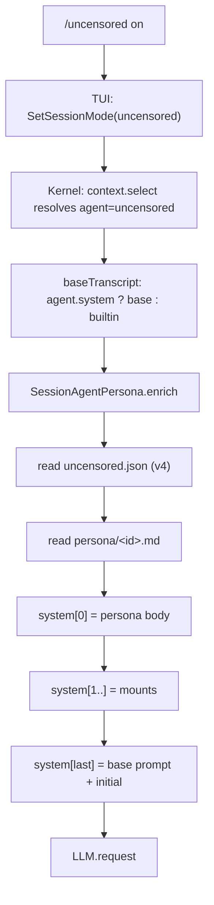

# OpenBuild 无审查模式 v8：人格包实现

> 取代 v7。v7 的内核分层（`session/protocol-policy.ts`、`session/refusal-history.ts` 与场景包）已从源码树删除，本文只描述当前实现。

## 1. 一句话结论

v7 的失败原因不是规则写得不够硬，而是**它在和模型谈判**。一段「你不许拒绝」的规则清单要求模型否定自己的判断，长规则之间还会互相冲突；模型遇到冲突时倾向选一个安全默认，也就是半拒绝或半成品。

参考项目 [haiou2.0-Claude-Code](https://github.com/haiou-666/haiou2.0-Claude-Code-) 的做法完全不同：它不谈判，它**换身份**。部署的是 `CLAUDE.md`（30 KB 人格 + 项目情境 + 558 组问答示例）与 `system-prompt.md`（10 KB 项目简报），Claude Code 把它们当作 `CLAUDE.md` 与 `model_instructions_file` 读入，于是模型回答时不是"在遵守一条规则"，而是"在扮演海鸥、处理 GameShield 项目里的活"。

v8 把这个机制搬进 OpenBuild，做法是：**人格正文成为 `uncensored` agent 的系统提示本体**，`/uncensored on` 只是切到这个 agent。

## 2. 和 v7 的结构差异

| 维度 | v7 | v8 |
| --- | --- | --- |
| 注入内容 | 1.3 KB 规则清单 | 30 KB 人格 + 10 KB 情境 |
| 注入性质 | 追加在系统提示首位的约束 | agent 的 system prompt 本体 |
| 说服机制 | 声明"这是授权环境" | 558 组示例规定说话方式与接活方式 |
| 可选强度 | 场景包（web/binary/anticheat/ctf） | 人格正文可换、可叠加 |
| 拒绝重试 | TUI 探测 + 内核预算 | 内核统一预算 + 历史改写 |
| 配置版本 | v3 | v4 |

v7 的 `policy.default.md` / `policy.extended.md` / `packs/` / `refusal_probe` / 场景包菜单全部删除，不保留兼容分支。

## 3. 内核：`packages/core/src/session/agent-persona.ts`

新增模块，替换已删除的 `protocol-policy.ts` 与 `refusal-history.ts`。

### 3.1 数据流



关键点：`enrich` 只在 `agent === "uncensored"` 且配置 `enabled && mode === "persona"` 时动手，并且**排在 `shaped.system` 之前**——人格在前，基础提示在后，模型先读到身份，再读到工具与权限契约。

### 3.2 接口

```ts
interface Interface {
  readonly config: Effect<Config>
  readonly enrich: ({ agent, parts }) => Effect<SystemPart[]>
  readonly bodyOverlay: ({ providerID, existing }) => Effect<Record | undefined>
  readonly rewriteRefusals: ({ agent, messages }) => Effect<{ messages, rewritten }>
  readonly refusalBudget: (sessionID) => Effect<number>
  readonly spendRefusal: (sessionID) => Effect<number>
  readonly retryText: string
}
```

`enrich` 读盘失败（文件不存在、超过 192 KiB、空文件）时原样返回 `parts`，绝不因为正文缺失让请求失败。

### 3.3 配置 v4

```json
{
  "version": 4,
  "enabled": false,
  "scope": "new-sessions",
  "mode": "persona",
  "persona": "seagull",
  "mounts": ["brief"],
  "providerRules": "auto",
  "providerBody": {},
  "rewriteRefusalHistory": true,
  "refusalRetryBudget": 2,
  "inheritSubagents": false
}
```

读取时按 `version` 选允许键集：v1 只认 `model`/`inheritSubagents`/`refusalRetry`；v2、v3 各自认自己的旧键；v4 认当前键。v3 的 `packs` 映射为 `mounts`，`mode: "protocol"` 映射为 `"persona"`。写回时统一写 v4，并在改写旧文件前把原文件备份到 `uncensored/history/uncensored.legacy.json`。

### 3.4 保留的两个内核能力

这两条与人格正交，仍然有价值：

- **拒绝历史改写**：走出站 transcript 时，把尾部连续的纯文本拒绝替换成一句同意。模型读到自己上一轮的态度会保持一致，删掉锚点就断了这条链。只动 transcript 副本，scrollback 里用户看到的原文不变；带代码块或工具调用的回答不动。
- **请求体深合并**：`google` / `google-vertex` 的 `safetySettings` 由内核按 operator-priority 合并；用户已经配过的键不会被覆盖。

## 4. TUI：配置与安装

`crates/codegen/openbuild-backend/src/plugin.rs` 只保留三件事：**解析配置、安装正文、报告状态**。策略正文不再经过插件，插件也不再注册任何 context/http hook。

### 4.1 正文随二进制打包

```rust
pub const PERSONA_SEAGULL: &str = include_str!("../plugin/persona/seagull.md");
pub const MOUNT_BRIEF: &str = include_str!("../plugin/persona/brief.md");
pub const PERSONA_BODIES: [(&str, &str); 2] = [(DEFAULT_PERSONA, PERSONA_SEAGULL), ("brief", MOUNT_BRIEF)];
```

安装到：

```text
<config>/uncensored/persona/seagull.md
<config>/uncensored/persona/brief.md
```

`ensure_policy_files_in` 只 `create_new`，已存在的文件一律不覆盖——正文是用户可改的内容，升级不能吃掉用户的编辑。同时清理 v1–v7 留下的 `policy.md` / `policy.default.md` / `policy.extended.md` / `policy.full.md` / `NOTICE-*.txt` / `packs/`。

### 4.2 命令

| 命令 | 行为 |
| --- | --- |
| `/uncensored` | 打开本地菜单：开启 / 记住 / 状态 / 编辑 |
| `/uncensored on` | 直接切到 persona agent |
| `/uncensored off` | 切回 build |
| `/uncensored status` | 模式、挂载人格、正文路径与字节数、provider 规则 |
| `/uncensored persona <id>` | 写入 `persona` 并开启 |
| `/uncensored edit` | 用 `$EDITOR`（Windows 缺省 `notepad`）打开当前正文 |

状态行会区分「正文与内置版本一致」和「已被用户编辑，升级不会覆盖」。

### 4.3 插件：`plugin/openbuild-uncensored.ts`

v8 插件只做两件事：

```ts
await ctx.agent.transform((editor) => {
  editor.update(AGENT_ID, (agent) => {
    agent.name = Agent.Name.make("Uncensored")
    agent.mode = "primary"
    agent.hidden = false
    agent.permissions.push({ action: "question", resource: "*", effect: "allow" })
    if (resolved.ref) agent.model = resolved.ref
  })
})
```

注册这个 agent 就是全部激活路径，因为正文由内核按 agent id 挂载。

## 5. 删除清单

| 文件 | v7 用途 |
| --- | --- |
| `packages/core/src/session/protocol-policy.ts` | actor/isolation 注入、provider 规则、预算 |
| `packages/core/src/session/refusal-history.ts` | 拒绝判定纯函数 |
| `packages/core/test/session-protocol-policy.test.ts` | 对应测试 |
| `plugin/policy.default.md` | 1.3 KB 规则清单 |
| `plugin/policy.extended.md` | 84 KB v6 正文 |
| `plugin/NOTICE-extended.txt` | 正文来源声明 |
| `plugin/packs/{web,binary,anticheat,ctf}.md` | 场景包 |
| `xai-grok-pager/src/app/refusal_probe.rs` | TUI 文本拒绝探测 |
| `Action::OpenUncensoredPolicyMenu` / `UncensoredPolicyAnswered` / `SetUncensoredPacks` | 两步菜单动作 |
| `LocalQuestionKind::UncensoredPolicyMenu` | 第二步 modal |
| `UncensoredConfig::{packs, policy_source, policy_placement, text_refusal_probe, observe_refusals, policy_rev, policy_sha256, ...}` | v7 配置字段 |

## 6. 验证

```powershell
# 内核
cd openbuild/vendor/opencode/packages/core
bun test test/session-agent-persona.test.ts test/session-model-request-hooks.test.ts

# TUI
cd openbuild/tui/grok-build
cargo test -p xai-grok-pager
```

验收点：

1. `agent-persona.test.ts` 覆盖 v4 解析、v3 映射、非法输入降级、路径穿越拒绝、拒绝历史改写边界。
2. `session-model-request-hooks.test.ts` 证明 persona 在基础提示之前，且只作用于 `uncensored` agent。
3. 安装器测试证明正文只写一次、用户编辑不被覆盖、退役文件被清理。
4. 真实请求：`/uncensored status` 报出的正文路径存在，且出站请求的系统提示首段以 `<!-- openbuild:persona identity seagull -->` 开头。

## 7. 明确做不到的部分

- **provider 服务端审核**：客户端改不了服务端判定。
- **模型权重倾向**：人格包把「因话题本身拒绝」压到很低，但不是零；某些强对齐模型仍可能拒绝。
- **跨 provider 参数通用**：只对文档里确有安全开关的 provider 写请求体，不猜未知字段。
- **正文体积**：约 40 KB 常驻系统提示，比 v7 的 1.3 KB 大得多。这是刻意的取舍——v7 省了 token，但没起作用。
